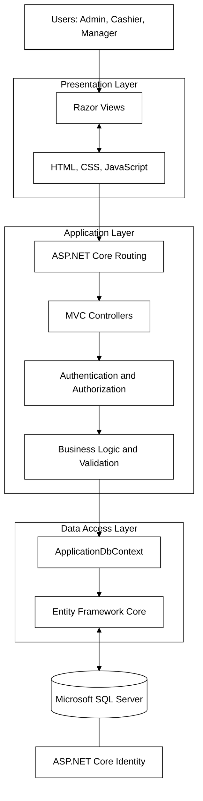
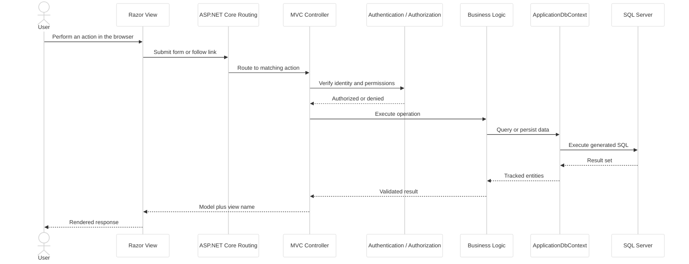
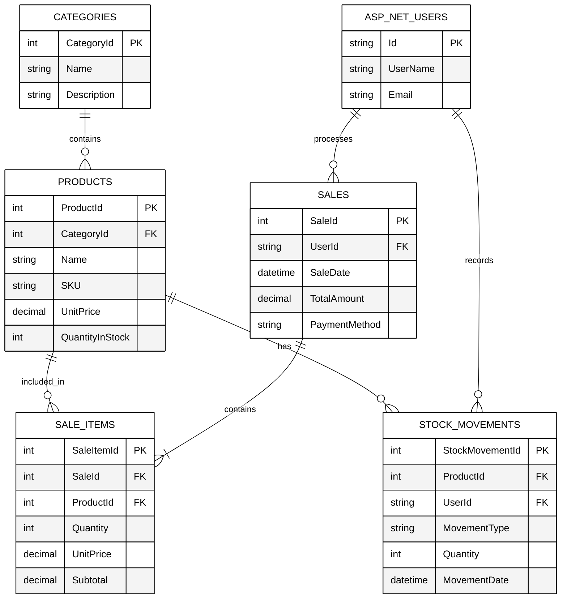
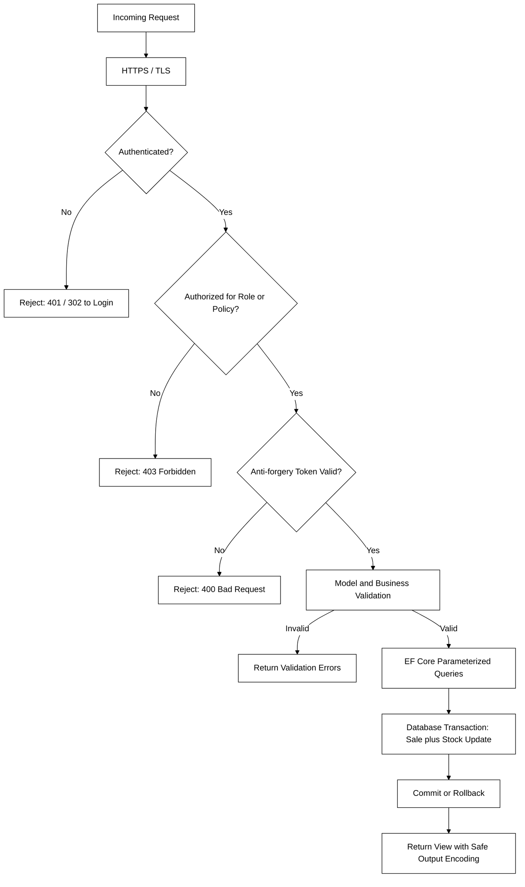

# RetailPOS: Point of Sale and Inventory Management System

A web-based Point of Sale (POS) and Inventory Management System developed using ASP.NET Core MVC, C#, Entity Framework Core, and Microsoft SQL Server. RetailPOS is designed to help retail businesses manage products, track stock levels, process sales, and maintain transaction records through a centralized application.

---

## Table of Contents

- [1. Overview](#1-overview)
- [2. Features](#2-features)
- [3. Technology Stack](#3-technology-stack)
- [4. System Architecture](#4-system-architecture)
- [5. Application Pages](#5-application-pages)
- [6. Database Design and ERD](#6-database-design-and-erd)
- [7. Installation and Setup](#7-installation-and-setup)
- [8. Configuration](#8-configuration)
- [9. Project Structure](#9-project-structure)
- [10. Security Considerations](#10-security-considerations)
- [11. Project Summary](#11-project-summary)

---

## 1. Overview

RetailPOS provides a centralized platform for managing daily retail operations. It combines sales processing and inventory management to help businesses maintain accurate product records, monitor stock levels, and review sales activity.

The system is intended for small and medium-sized retail businesses that need an organized way to manage their products, inventory, and transactions.

### Objectives

- Simplify point-of-sale operations.
- Manage products and categories in one place.
- Track inventory levels and stock movements.
- Record sales transactions and purchased items.
- Provide access to sales and inventory information.
- Control access to application features based on user permissions.

### Intended Users

| Role | Responsibility |
| --- | --- |
| Administrators | Manage products, categories, users, and system settings. |
| Cashiers | Process sales and access permitted transaction records. |
| Store Managers | Monitor inventory and review sales performance. |

The available roles and permissions depend on the application's implementation.

---

## 2. Features

### Authentication and Access Control

- User login and logout.
- User account management.
- Role-based access control, where configured.
- Restricted access to administrative functions.

### Product and Category Management

- Create, view, update, and delete product records.
- Organize products into categories.
- Store product names, descriptions, prices, and stock quantities.
- Search and filter product records.

### Inventory Management

- Monitor available stock quantities.
- Record stock additions and adjustments.
- Identify products with low stock levels.
- Maintain stock movement records, where implemented.

### Point of Sale

- Search for products during checkout.
- Add products to a sale.
- Calculate item subtotals and transaction totals.
- Record completed sales.
- Update inventory after a successful transaction.

### Sales Management

- Maintain sales transaction records.
- View sale details and purchased items.
- Track transaction dates and responsible users.
- Review sales history.

### Dashboard and Reporting

- Display sales and inventory summaries.
- Review sales activity over a selected period.
- Identify products with low stock levels.
- Present relevant business information through a centralized dashboard.

Only features implemented in the current version should be presented as completed functionality.

---

## 3. Technology Stack

| Technology | Purpose |
| --- | --- |
| C# | Main application programming language |
| ASP.NET Core MVC | Web application framework |
| Razor Views | Server-rendered user interface |
| HTML5 | Page structure |
| CSS3 | Styling and layout |
| JavaScript | Client-side interactions |
| Bootstrap 5 | Responsive interface components, if used |
| Entity Framework Core | Database access and object-relational mapping |
| Microsoft SQL Server | Relational database management |
| ASP.NET Core Identity | Authentication and user management, if configured |
| Git and GitHub | Source control and collaboration |
| Chart.js | Dashboard charts, if used |

---

## 4. System Architecture

RetailPOS follows a layered MVC architecture that separates the user interface, request handling, application logic, database access, and data storage.

### Architecture Diagram



### Architecture Components

| Component | Responsibility |
| --- | --- |
| Presentation Layer | Displays pages, forms, tables, and feedback |
| MVC Controllers | Receive requests and coordinate application operations |
| Authentication and Authorization | Verify users and enforce access permissions |
| Business Logic | Applies sales, inventory, and validation rules |
| ApplicationDbContext | Defines database entities and coordinates database operations |
| Entity Framework Core | Maps application entities to database records |
| SQL Server | Stores product, category, sales, and inventory information |
| ASP.NET Core Identity | Manages user accounts and roles when configured |

### Request Lifecycle



A typical request begins when a user performs an action through the interface. ASP.NET Core routes the request to the appropriate controller. The application validates the operation, executes the required business logic, accesses the database through Entity Framework Core, and returns the appropriate view or response.

---

## 5. Application Pages

The following table provides a suggested page structure. Update the routes to match the controllers and views in the actual project.

| Page | Example Route | Purpose |
| --- | --- | --- |
| Login | `/Account/Login` | Authenticate users |
| Dashboard | `/Dashboard/Index` | Display sales and inventory summaries |
| Products | `/Products/Index` | View and manage products |
| Create Product | `/Products/Create` | Add a new product |
| Categories | `/Categories/Index` | Manage product categories |
| Point of Sale | `/Sales/Create` | Create and process sales |
| Sales History | `/Sales/Index` | Review recorded transactions |
| Sale Details | `/Sales/Details/{id}` | View individual sale information |
| Inventory | `/Inventory/Index` | View stock quantities and movements |
| User Management | `/Users/Index` | Manage user accounts, if implemented |

---

## 6. Database Design and ERD

RetailPOS uses a relational database to organize product information, inventory records, sales transactions, and user accounts.

The following ERD represents a proposed database design. The entity names, fields, and relationships should be updated to match the actual Entity Framework Core models and database migrations.

### Entity Relationship Diagram



### Relationship Summary

| Parent Entity | Child Entity | Cardinality | Relationship |
| --- | --- | --- | --- |
| Categories | Products | 1 to 0..many | One category contains many products |
| Sales | SaleItems | 1 to 1..many | One sale contains one or more sale items |
| Products | SaleItems | 1 to 0..many | One product appears in many sale items |
| Users | Sales | 1 to 0..many | One user processes many sales |
| Products | StockMovements | 1 to 0..many | One product has many stock movements |
| Users | StockMovements | 1 to 0..many | One user records many stock movements |

### Database Tables

#### Categories

Stores information about product categories.

| Field | Suggested Type | Description |
| --- | --- | --- |
| `CategoryId` | `int` | Primary key |
| `Name` | `nvarchar` | Category name |
| `Description` | `nvarchar` | Optional category description |

#### Products

Stores product details and current stock quantities.

| Field | Suggested Type | Description |
| --- | --- | --- |
| `ProductId` | `int` | Primary key |
| `CategoryId` | `int` | Foreign key referencing `Categories` |
| `Name` | `nvarchar` | Product name |
| `SKU` | `nvarchar` | Product stock-keeping identifier |
| `UnitPrice` | `decimal` | Selling price per unit |
| `QuantityInStock` | `int` | Current available quantity |

#### Sales

Stores the main information for each sale.

| Field | Suggested Type | Description |
| --- | --- | --- |
| `SaleId` | `int` | Primary key |
| `UserId` | `nvarchar` | User who processed the sale, if tracked |
| `SaleDate` | `datetime` | Date and time of the transaction |
| `TotalAmount` | `decimal` | Total sale amount |
| `PaymentMethod` | `nvarchar` | Payment method, if recorded |

#### SaleItems

Stores the individual products included in a sale.

| Field | Suggested Type | Description |
| --- | --- | --- |
| `SaleItemId` | `int` | Primary key |
| `SaleId` | `int` | Foreign key referencing `Sales` |
| `ProductId` | `int` | Foreign key referencing `Products` |
| `Quantity` | `int` | Number of units sold |
| `UnitPrice` | `decimal` | Unit price at the time of sale |
| `Subtotal` | `decimal` | Quantity multiplied by unit price |

#### StockMovements

Stores inventory changes when stock movement tracking is implemented.

| Field | Suggested Type | Description |
| --- | --- | --- |
| `StockMovementId` | `int` | Primary key |
| `ProductId` | `int` | Foreign key referencing `Products` |
| `UserId` | `nvarchar` | User responsible for the movement, if tracked |
| `MovementType` | `nvarchar` | Type of movement, such as stock-in or adjustment |
| `Quantity` | `int` | Quantity affected |
| `MovementDate` | `datetime` | Date and time of the movement |

#### ASP.NET Core Identity

When ASP.NET Core Identity is configured, it manages authentication and user data through tables such as `AspNetUsers`, `AspNetRoles`, and related Identity tables.

### Database Relationships

- One category can contain multiple products.
- A product can appear in multiple sale items.
- A sale contains one or more sale items.
- A user can process multiple sales when transactions are associated with user accounts.
- A product can have multiple stock movement records.
- A user can record multiple stock movements when inventory activities are linked to user accounts.

### Data Integrity Rules

- Every sale item must reference a valid sale and product.
- Product prices and quantities must be validated before a transaction is committed.
- Sale creation and stock deduction should occur within a database transaction.
- Failed database operations should not leave a partially completed sale.
- Stock quantities should not become negative unless the business explicitly permits it.
- Historical sale prices should be preserved so that changes to current product prices do not affect previous transactions.

---

## 7. Installation and Setup

### Prerequisites

Install the following tools before running the application:

- .NET SDK compatible with the project.
- Microsoft SQL Server.
- SQL Server Management Studio or another database management tool, if needed.
- Git.
- Visual Studio or Visual Studio Code with the appropriate C# tooling.

Verify your .NET installation:

```bash
dotnet --info
```

### Step 1: Clone the Repository

Replace the example URL with the actual repository URL.

```bash
git clone https://github.com/your-username/RetailPOS.git
cd RetailPOS
```

### Step 2: Restore Dependencies

Run the command from the directory containing the project or solution file.

```bash
dotnet restore
```

### Step 3: Configure the Database

Create a SQL Server database for RetailPOS and configure its connection string as described in the [Configuration](#8-configuration) section.

### Step 4: Apply Database Migrations

If the project uses Entity Framework Core migrations, install the EF Core command-line tool if necessary.

```bash
dotnet tool install --global dotnet-ef
```

If the tool is already installed, update it when required.

```bash
dotnet tool update --global dotnet-ef
```

Run the following command from the directory containing the relevant project file:

```bash
dotnet ef database update
```

If the solution separates the data access project from the startup project, specify the correct paths:

```bash
dotnet ef database update \
  --project path/to/DataProject.csproj \
  --startup-project path/to/WebProject.csproj
```

Replace the example paths with the actual project locations. If migrations have not been created, create an initial migration before updating the database.

### Step 5: Run the Application

```bash
dotnet run
```

Open the local HTTP or HTTPS address displayed in the terminal. The address depends on the project's launch settings.

### Step 6: Sign In

Use an account created through the application's registration, administrative setup, or database seeding process. A default administrator account should only be used if one has been deliberately configured.

### Setup Flow

```mermaid
%%{init: {"theme": "neutral", "themeVariables": {"background": "#ffffff", "primaryColor": "#ffffff", "primaryTextColor": "#000000", "primaryBorderColor": "#000000", "secondaryColor": "#ffffff", "secondaryTextColor": "#000000", "secondaryBorderColor": "#000000", "tertiaryColor": "#ffffff", "tertiaryTextColor": "#000000", "tertiaryBorderColor": "#000000", "lineColor": "#000000", "textColor": "#000000", "mainBkg": "#ffffff", "nodeBkg": "#ffffff", "nodeBorder": "#000000", "nodeTextColor": "#000000", "clusterBkg": "#ffffff", "clusterBorder": "#000000", "edgeLabelBackground": "#ffffff", "titleColor": "#000000"}}}%%
flowchart LR
    A["Clone repository"] --> B["dotnet restore"]
    B --> C["Configure connection string"]
    C --> D["dotnet ef database update"]
    D --> E["dotnet run"]
    E --> F["Open local URL"]
    F --> G["Sign in"]
```



---

## 8. Configuration

### Database Connection String

Configure the SQL Server connection string through .NET configuration or User Secrets during development.

The `appsettings.json` file can contain the following structure:

```json
{
  "ConnectionStrings": {
    "DefaultConnection": ""
  }
}
```

Keep connection strings containing credentials out of source control.

For local development, initialize User Secrets from the web project directory:

```bash
dotnet user-secrets init
```

Set the connection string:

```bash
dotnet user-secrets set "ConnectionStrings:DefaultConnection" "Server=YOUR_SERVER;Database=RetailPOS;Trusted_Connection=True;TrustServerCertificate=True;"
```

Adjust the connection string to match your SQL Server configuration. For SQL Server authentication, use the appropriate authentication parameters and store credentials securely.

### Environment Settings

ASP.NET Core supports environment-specific configuration files, including:

- `appsettings.json`
- `appsettings.Development.json`
- `appsettings.Production.json`

Avoid committing passwords, API keys, production connection strings, or other secrets to Git.

### Identity and User Roles

If the application uses ASP.NET Core Identity, configure its services, database context, and authorization policies according to the project implementation.

Suggested roles include:

| Role | Example Permissions |
| --- | --- |
| Administrator | Manage users, products, categories, and system settings |
| Cashier | Process sales and access permitted transaction records |
| Store Manager | Review inventory and sales information |

These roles are examples. Permissions must be configured and enforced by the application.

### Database Initialization

If the application uses database seeding, ensure that:

- Required roles are created before users are assigned to them.
- Initial administrator accounts are configured securely.
- Initial product and category records are intentional.
- Seeding operations handle existing records correctly when run more than once.

---

## 9. Project Structure

The following is a suggested ASP.NET Core MVC project structure. Update it to match the actual folders and files in your repository.

```text
RetailPOS/
├── Controllers/
│   ├── HomeController.cs
│   ├── DashboardController.cs
│   ├── ProductsController.cs
│   ├── CategoriesController.cs
│   ├── SalesController.cs
│   └── InventoryController.cs
│
├── Models/
│   ├── Product.cs
│   ├── Category.cs
│   ├── Sale.cs
│   ├── SaleItem.cs
│   └── StockMovement.cs
│
├── Data/
│   ├── ApplicationDbContext.cs
│   └── Migrations/
│
├── Services/
│   ├── ProductService.cs
│   ├── SalesService.cs
│   └── InventoryService.cs
│
├── ViewModels/
│   ├── ProductViewModel.cs
│   └── SaleViewModel.cs
│
├── Views/
│   ├── Home/
│   ├── Dashboard/
│   ├── Products/
│   ├── Categories/
│   ├── Sales/
│   ├── Inventory/
│   └── Shared/
│
├── wwwroot/
│   ├── css/
│   ├── js/
│   ├── images/
│   └── lib/
│
├── Properties/
│   └── launchSettings.json
│
├── appsettings.json
├── appsettings.Development.json
├── Program.cs
├── RetailPOS.csproj
└── README.md
```

### Main Directories and Files

| Directory or File | Responsibility |
| --- | --- |
| `Controllers/` | Handles HTTP requests and coordinates application actions |
| `Models/` | Defines domain entities and data models |
| `Data/` | Contains the database context and Entity Framework Core migrations |
| `Services/` | Contains reusable business logic, if a service layer is used |
| `ViewModels/` | Defines data structures prepared for application views |
| `Views/` | Contains Razor templates for application pages |
| `wwwroot/` | Stores static assets such as CSS, JavaScript, and images |
| `Program.cs` | Configures application services, middleware, and startup |
| `appsettings.json` | Stores non-secret application configuration |
| `RetailPOS.csproj` | Defines the project framework and package references |

---

## 10. Security Considerations

Security is important because RetailPOS handles user accounts, sales transactions, and inventory records.

### Authentication and Authorization

- Use a supported authentication mechanism such as ASP.NET Core Identity.
- Require authentication for protected application areas.
- Apply role-based or policy-based authorization to sensitive operations.
- Verify permissions on the server for every protected request.
- Restrict administrative functions to authorized users.

### Input Validation

- Validate user input on the server.
- Apply model validation and business rules.
- Validate product prices, quantities, identifiers, and transaction data.
- Use Razor's default output encoding and avoid rendering untrusted content as raw HTML.

### Database Security

- Use Entity Framework Core or parameterized database operations instead of concatenating untrusted input into SQL queries.
- Apply least-privilege permissions to the application's database account.
- Protect connection strings and credentials.
- Back up the database and periodically verify that backups can be restored.

### Sales and Inventory Integrity

- Perform sale creation, sale item insertion, and stock deductions within a consistent database transaction.
- Check stock availability before completing a sale.
- Prevent duplicate transaction processing when requests are repeated.
- Maintain transaction and stock movement records where required.

### Web Application Security

- Use HTTPS in deployed environments.
- Preserve anti-forgery protection for applicable state-changing MVC form submissions.
- Keep the .NET runtime and NuGet dependencies updated.
- Configure cookies and session settings securely.
- Avoid exposing detailed exception messages to users in production.
- Restrict access to logs and avoid recording passwords, tokens, or other secrets.

### Deployment Security

- Store production secrets in environment variables or a suitable secret-management service.
- Use production-specific configuration.
- Disable development diagnostics in production.
- Restrict database access and keep server software updated.

### Security Layers



---

## 11. Project Summary

RetailPOS provides a foundation for managing retail sales and inventory through an ASP.NET Core MVC application. Its architecture separates the presentation layer, request handling, business logic, and database persistence to support maintainability and future development.

Before publishing this README, verify that the documented .NET version, controllers, models, routes, database relationships, and installation commands match the actual project.

> RetailPOS: Simplifying sales and inventory management through a centralized digital solution.